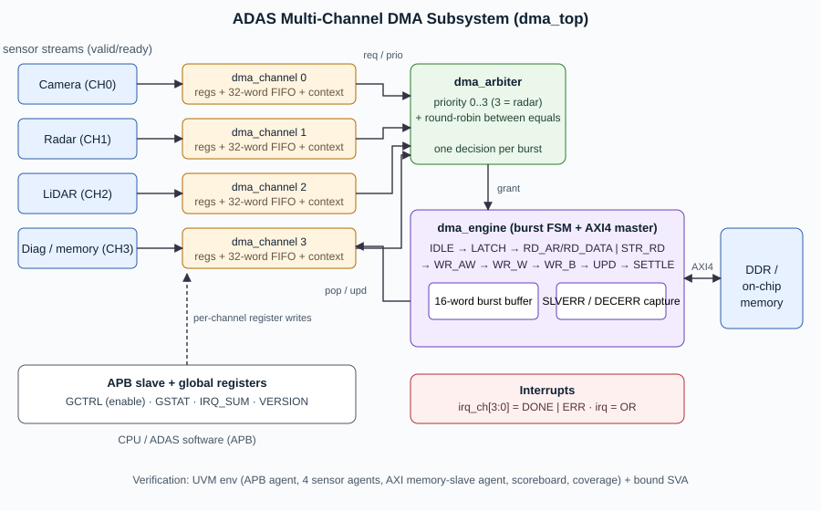

# 2. Architecture



## 2.1 Module hierarchy

```
dma_top                     APB decode, global regs, irq OR
 ├─ dma_channel  x4         config regs, run-time context, sensor FIFO, request logic, interrupts
 │    └─ dma_sfifo          32 x 32 FWFT FIFO (maps to LUT-RAM)
 ├─ dma_arbiter             priority + round-robin, one decision per burst
 └─ dma_engine              burst FSM, 16-word burst buffer, AXI4 master
```

## 2.2 Data path

Every burst is **store-and-forward** through one 16-word burst buffer in the engine:

```
 memory source :  AXI read  (AR/R)  ──►  burst buffer  ──►  AXI write (AW/W/B)  ──►  memory
 sensor source :  channel FIFO pop  ──►  burst buffer  ──►  AXI write (AW/W/B)  ──►  memory
```

Store-and-forward keeps the AXI side simple (a write burst can never stall half-way waiting for
source data, so WLAST/WVALID rules are trivially met) and lets the bus be released between bursts.
The cost is one burst of latency, which is why the maximum burst length is limited to 16 beats and
is programmable per channel (radar uses 4-beat bursts for low latency, the camera uses 16).

## 2.3 Transfer FSM (`dma_engine`)

```
        grant            capture                 mem source
 IDLE ───────► LATCH ───────────────► ┬─► RD_AR ─► RD_DATA ─┐
  ▲                                   │                      ├─► WR_AW ─► WR_W ─► WR_B ─► UPD ─► SETTLE ─┐
  │                                   └─► STR_RD ───────────┘                                            │
  └─────────────────────────────────────────────────────────────────────────────────────────────────────┘
```

| State | Action |
|---|---|
| IDLE | arbiter result is valid -> remember the winning channel |
| LATCH | copy burst size, source and destination address from the winner (breaks a long timing path) |
| RD_AR / RD_DATA | issue the read burst, collect beats, remember the first non-OKAY response |
| STR_RD | pop `beats` words from the sensor FIFO (the channel only requests once the FIFO holds enough) |
| WR_AW / WR_W / WR_B | issue the write burst, stream the buffer, wait for the response |
| UPD | tell the channel how many words moved and with what error code (a read error skips the write) |
| SETTLE | one idle cycle so the channel's registered request reflects the updated context |

## 2.4 Burst sizing and the 4 KB rule

For channel `c` the next burst has

```
beats = min( BLEN+1 , words remaining , words left in the destination 4KB page ,
             words left in the source 4KB page  (memory source only) )
```

so a transfer that starts 5 words below a page boundary naturally becomes `5 + 16 + 16 + ...`
beats.  All terms are saturated to 6 bits so the logic stays small and fast.  The testbench
re-implements this formula independently and checks every burst on the bus.

## 2.5 Arbitration scheme

* Each channel presents `req` (active, enabled, and - for sensor channels - enough words in its FIFO) and a 2-bit `prio`.
* The highest priority wins; ties are broken by a round-robin pointer that starts just after the last winner.
* Arbitration is per burst, so the worst-case extra latency of the most critical channel is *one* burst of any other channel.

| Setting | Behaviour |
|---|---|
| different priorities | strict priority - the highest priority requester is always served first |
| equal priorities | round-robin |

## 2.6 Channel life-cycle

```
          START (valid cfg)                last burst done
 IDLE ───────────────────────► ACTIVE ───────────────────────► IDLE  (INT_STAT.DONE)
   ▲  START (bad cfg) -> ERR_CFG   │
   └───────────────────────────────┴───── bus error: go IDLE, ERR + error code (restart with a new START)
```

## 2.7 Interrupts

`INT_STAT` bits (write-1-to-clear), `INT_EN` masks them, `irq_ch[c] = |(INT_STAT & INT_EN)`, `irq = |irq_ch`.

| Bit | Name | Set when |
|---|---|---|
| 0 | DONE | all `LEN` words moved |
| 1 | ERR | SLVERR / DECERR / illegal config - cause in `STATUS.ERR_CODE` |

## 2.8 Timing decisions made during synthesis

The first synthesis run failed timing (WNS -8.1 ns at 10 ns) and used 6000 flip-flops because the
FIFO / burst-buffer memories had a reset.  Two RTL changes fixed this and are documented here because
they explain the `SETTLE` / `LATCH` states:

1. Memories are written in reset-free `always_ff` blocks, so Vivado maps them to LUT-RAM.
2. The channel's `req` and `next_beats` are **registered**, and the engine spends one `SETTLE` cycle after each burst so the register is up to date; burst parameters are captured in a separate `LATCH` cycle. Cost: 2 cycles per burst (~5 % of a 16-beat burst).

## 2.9 Known limitations

* One outstanding burst (no read/write overlap).
* 32-bit data only, INCR bursts only, no AXI IDs, no descriptors in memory (registers only).
* Strict priority: a never-ending high-priority channel can delay lower priorities until it finishes (intentional for safety-critical radar).
* A memory that never answers is not detected (no watchdog); the testbench memory always answers.
